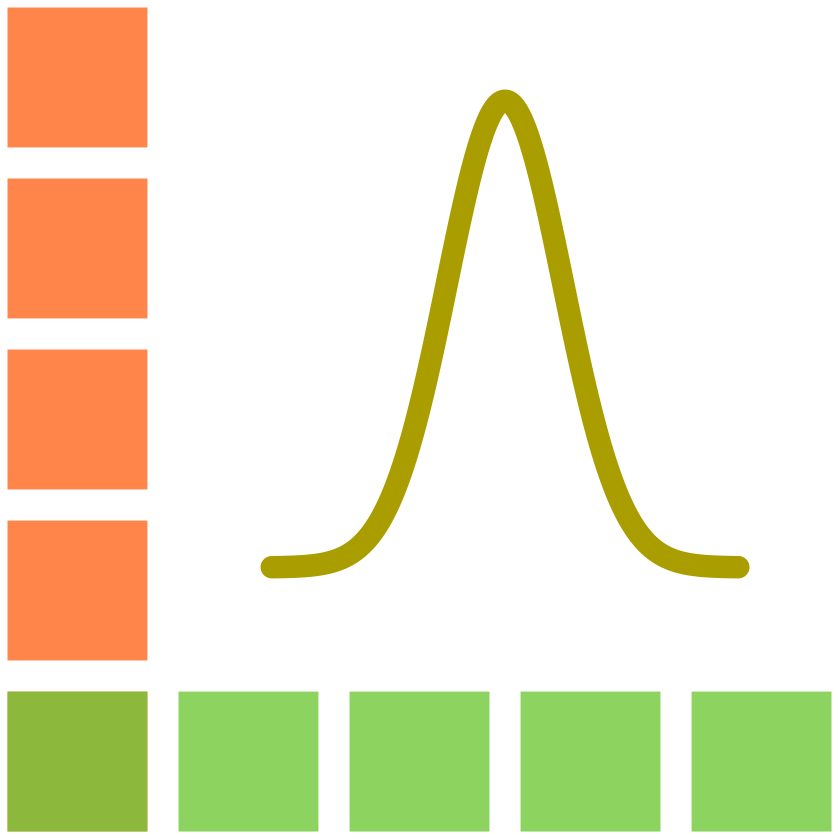

<p align="center">

</p>


# iq: an R package for protein quantification

This R package provides an implementation of the MaxLFQ method by Cox et al. (2014) in a comprehensive pipeline for DIA-MS (Pham et al. 2020; Pham et al. 2026). It also offers options for protein quantification using the N most intense fragment ions, using all fragment ions, Tukey's median polish algorithm, a robust linear model, and feature weighting. In general, the tool can be used to integrate multiple proportional observations into a single quantitative value.

**Citation**

Pham TV, Tran CTM, Henneman AA, Pham LHC, Le DG, Can AH, Bui PHL, Piersma SR, Jimenez CR. Boosting the speed and accuracy of protein quantification algorithms in mass spectrometry-based proteomics. _Journal of Proteome Research_ 2026 Feb 6; 25(2):1198-1203.
[https://doi.org/10.1021/acs.jproteome.5c01038](https://doi.org/10.1021/acs.jproteome.5c01038)


For version 1.x.x, please cite

Pham TV, Henneman AA, Jimenez CR. iq: an R package to estimate relative protein abundances from ion quantification in DIA-MS-based proteomics, _Bioinformatics_ 2020 Apr 15;36(8):2611-2613.
[https://doi.org/10.1093/bioinformatics/btz961](https://doi.org/10.1093/bioinformatics/btz961)


## Installation

The package is hosted on CRAN. It is best to install from within R.

```
install.packages("iq")
```

## Usage

The package can be loaded in the usual manner

```
library("iq")
```

See [a recent example](https://cran.r-project.org/web/packages/iq/vignettes/iq-fast.html) for processing a Spectronaut output. 

Or [an older vignette](https://cran.r-project.org/web/packages/iq/vignettes/iq.html) for processing output from Spectronaut, OpenSWATH and MaxQuant with some visualization.


***To process a DIA-NN output with `process`***

The function `process` reads a DIA-NN report, filters and normalizes the data, quantifies all proteins and writes a table with one row per protein and one column per sample, in one call. It reads a `.parquet` file directly (with the package `arrow`), a tab-separated text file such as `report.tsv`, or a data frame, with the same arguments for all three. By default, it uses the precursor quantities `Precursor.Normalised` per `Run`, keeps `Q.Value` and `PG.Q.Value` below 0.01, and quantifies with the _maxlfq-bit_ method. The estimates of each protein are then rescaled so that their mean equals the mean of its data in log2 space (`rescale_method = "to_mean"`); use `rescale_method = NULL` for no rescaling.

The filters in the following examples are those for a DIA-NN match-between-runs (MBR) search.

```
iq::process("report.parquet", "report-protein-group.txt",
            sample_id = "Run",
            intensity_col = "Precursor.Normalised",            
            annotation_col = c("Protein.Names", "Genes"),
            filter_double_less = c("Q.Value" = "0.01",
                                   "PG.Q.Value" = "0.05",
                                   "Lib.Peptidoform.Q.Value" = "0.01",
                                   "Global.Q.Value" = "0.01",
                                   "Global.PG.Q.Value" = "0.01"),
            method = "maxlfq_bit",
            log2_intensity_cutoff = 0)
```

To use the MS/MS fragment intensities instead (DIA-NN 2.x with the --export-quant option), give the fragment columns.

```
iq::process("report.parquet", "report-protein-group.txt",
            intensity_col = paste0("Fr.", 0:11, ".Quantity"),
            intensity_col_id = paste0("Fr.", 0:11, ".Id"),
            annotation_col = c("Protein.Names", "Genes"),
            filter_double_less = c("Q.Value" = "0.01",
                                   "PG.Q.Value" = "0.05",
                                   "Lib.Peptidoform.Q.Value" = "0.01",
                                   "Global.Q.Value" = "0.01",
                                   "Global.PG.Q.Value" = "0.01"))
```

To add the number of fragments and peptides per protein, the peptides, the summed intensities (XIC) and the sequence coverage, give a function that maps a precursor id to its peptide sequence and, for the coverage, the protein sequences from a FASTA file that the data were searched with.

```
fasta <- iq::read_fasta_file("uniprot_human.fasta")

iq::process("report.parquet", "report-protein-group.txt",
            sample_id = "Run",
            intensity_col = "Precursor.Normalised",            
            annotation_col = c("Protein.Names", "Genes"),
            filter_double_less = c("Q.Value" = "0.01",
                                   "PG.Q.Value" = "0.05",
                                   "Lib.Peptidoform.Q.Value" = "0.01",
                                   "Global.Q.Value" = "0.01",
                                   "Global.PG.Q.Value" = "0.01"),
            method = "maxlfq_bit",
            log2_intensity_cutoff = 0,
            peptide_extractor = function(x) gsub("\\(UniMod:\\d+\\)|\\d", "", x),
            rfasta = fasta)
```

The extractor above removes the modifications and the charge, e.g. `(UniMod:1)AAAAAAGAGPEMVR2` becomes `AAAAAAGAGPEMVR`. Other quantification methods are chosen with `method`, see `?process` for all options. For data too large to fit in memory, see the iq data format below.

***To process a Spectronaut output***

Use this export schema [iq.rs](https://github.com/tvpham/iq/releases/download/v1.1/iq.rs) to make a long report, for example "Spectronaut_Report.xls".

```
iq::process("Spectronaut_Report.xls",
            output_filename = "iq-MaxLFQ.tsv", 
            sample_id  = "R.FileName",
            primary_id = "PG.ProteinGroups",
            secondary_id = c("EG.Library", "FG.Id", "FG.Charge", "F.FrgIon", 
                             "F.Charge", "F.FrgLossType"),
            intensity_col = "F.PeakArea",
            annotation_col = c("PG.Genes", "PG.ProteinNames", "PG.FastaFiles"),
            filter_string_equal = c("F.ExcludedFromQuantification" = "False"),
            filter_double_less = c("PG.Qvalue" = "0.01", "EG.Qvalue" = "0.01"),
            log2_intensity_cutoff = 0)

```

***A simple example***

Quantify a data matrix for a single protein
```
X <- matrix(c(10, 12, 12, NA, NA, 10), nrow = 2, 
            dimnames = list(c("ion1", "ion2"), 
                            c("sample1", "sample2", "sample3")))

#      sample1 sample2 sample3
# ion1      10      12      NA
# ion2      12      NA      10

iq::process_matrix(X, method = "maxlfq_bit", rescale_method = NULL)

# [1] 11 13  9
```

The result by maxlfq-bit shows that sample2 is 4-fold higher than sample1 (difference of 2 in log2 space). These two samples share ion1 only, whose quantitative difference is reflected in the result. Similarly, sample1 is 4-fold higher than sample3.

Since the quantification is relative, we can rescale the result to the total intensity

```
iq::process_matrix(X, method = "maxlfq_bit", rescale_method = "to_sum")

# [1] 10.929611 12.929611  8.929611

sum(2^X, na.rm = TRUE)
# [1] 10240

sum(2^iq::process_matrix(X, method = "maxlfq_bit", rescale_method = "to_sum"))
# [1] 10240

```

***The new iq data format***

A new data format is introduced to support large-scale data processing. This example converts the usual tab-delimited format file [Bruderer15-DIA-longformat-compact.txt.gz](https://github.com/tvpham/iq/releases/download/v1.1/Bruderer15-DIA-longformat-compact.txt.gz) to the new iq format. Decompress the downloaded file first, as gzipped files are not read directly.

```
primary_id <- "PG.ProteinGroups"
sample_id  <- "R.Condition" 
secondary_id <- c("EG.ModifiedSequence", "FG.Charge", "F.FrgIon", "F.Charge")
annotation_col <- c("PG.Genes", "PG.ProteinNames")

iq::long_format_to_iq_format("Bruderer15-DIA-longformat-compact.txt", "bruderer15.iq", 
                        primary_id = primary_id,
                        secondary_id = secondary_id,
                        sample_id = sample_id,
                        annotation_col = annotation_col,
                        intensity_col = "F.PeakArea",
                        filter_double_less = NULL)
```

The new data is contained in a folder **bruderer15.iq**. Then we can process the data using different methods

```
iq::process_iq_format("bruderer15.iq", output_filename = "result-maxlfq_bit.tsv",
                      method = "maxlfq_bit")

iq::process_iq_format("bruderer15.iq", output_filename = "result-median_polish.tsv",
                      method = "median_polish")
```


***Cluster processing***

The iq data format makes it very easy to process subsets of proteins on different processing nodes. Here is an example of using the Dutch national computing cluster for processing. You will need to adapt the shell script to your cluster processing and storage architecture.
```
#!/bin/bash
#SBATCH --array=0-119
#SBATCH --time=5:00
#SBATCH --mem=32G

RANGES_FILE=ranges.txt

LOCAL_DIR=/gpfs/work4/0/prjs0919/iq/cluster-processing

R_SCRIPT=$LOCAL_DIR/script.R

OUTPUT_DIR=$LOCAL_DIR/res_files
INPUT_DIR=$LOCAL_DIR/data.iq

RANGES_FILE=$LOCAL_DIR/ranges.txt

mapfile -t <$RANGES_FILE PROTEIN_RANGES

# This needs to be synchronized by hand with the
# --array length
# wc -l ranges.txt
## 120 ranges.txt

RANGE_VALUES=${PROTEIN_RANGES[$SLURM_ARRAY_TASK_ID]}

module load 2024
module load R/4.4.2-gfbf-2024a

OUTPUT_FILE_PREFIX=$OUTPUT_DIR/res
METHOD="maxlfq_bit"

srun $R_SCRIPT $INPUT_DIR $OUTPUT_FILE_PREFIX $METHOD $RANGE_VALUES

```

In this example, we process a dataset of 11987 proteins (**data.iq**) using the **maxlfq_bit** algorithm. We split the data into 120 partitions (file **ranges.txt**). An R script **script.R** is called in each node to process the data.
