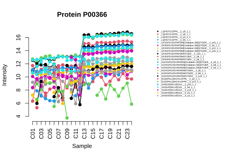

Version 2 of **iq** (Pham et al. 2026) introduces the _maxlfq-bit_ algorithm and other algorithms for robust and large-scale protein quantification, and a data format for datasets too large to hold in memory. The examples below use the dataset `spikeins` that comes with the package to illustrate their use.


``` r
library("iq")
data("spikeins")
head(spikeins, 3)
#>   R.Condition PG.ProteinGroups    EG.ModifiedSequence FG.Charge
#> 1         C01           P02754 _VYVEELKPTPEGDLEILLQK_         3
#> 2         C01           P02754 _VYVEELKPTPEGDLEILLQK_         3
#> 3         C01           P02754 _VYVEELKPTPEGDLEILLQK_         3
#>   F.FrgIon F.Charge F.PeakArea PG.Genes PG.ProteinNames
#> 1      y13        1   38685.53      LGB      LACB_BOVIN
#> 2      y18        2   19320.07      LGB      LACB_BOVIN
#> 3      y17        2   13800.84      LGB      LACB_BOVIN
```

The data are a Spectronaut export of 12 spike-in proteins in 24 samples (Bruderer et al. 2015), with fragment ion intensities in `F.PeakArea`.

## One-liner: `process()`

`process()` reads a long-format table, filters the rows, removes low intensities (by default those of 1 or less, `log2_intensity_cutoff = 0`), performs median normalization, quantifies every protein and writes a table with one row per protein and one column per sample (log2 values). The input can be a data frame, as here, a tab-separated text file, or a `.parquet` file. The example data have already been normalized, so we turn off the normalization with `normalization = "none"`.


``` r
output_file <- file.path(tempdir(), "spikeins-maxlfq_bit.tsv")

iq::process(spikeins, output_file,
            sample_id = "R.Condition",
            primary_id = "PG.ProteinGroups",
            secondary_id = c("EG.ModifiedSequence", "FG.Charge", "F.FrgIon", "F.Charge"),
            intensity_col = "F.PeakArea",
            annotation_col = c("PG.Genes", "PG.ProteinNames"),
            filter_double_less = NULL,
            normalization = "none",
            pdf_out = NULL,
            verbose = FALSE)

result <- read.delim(output_file, check.names = FALSE)
result[1:3, 1:6]
#>   PG.ProteinGroups PG.Genes PG.ProteinNames      C01      C02
#> 1           P02754      LGB      LACB_BOVIN 12.88991 12.84917
#> 2           P80025      LPO      PERL_BOVIN 10.51810 10.61247
#> 3           P00921      CA2      CAH2_BOVIN 11.37282 11.32456
#>        C03
#> 1 12.87497
#> 2 10.55833
#> 3 11.33720
```

The default method is _maxlfq-bit_; others are chosen with `method`, e.g. `method = "median_polish"` or `method = "weighted_rlm"`. By default, the estimates of each protein are shifted so that their mean equals the mean of its input data in log2 space (`rescale_method = "to_mean"`); with `rescale_method = "to_sum"`, their intensities add up to those of its input data.

The defaults of `process()` are those of a DIA-NN report: the precursor quantities `Precursor.Normalised` per `Run`, with `Q.Value` and `PG.Q.Value` below 0.01. For a DIA-NN search with match-between-runs (MBR), one can use the following filters given with the `filter_double_less` parameter.


``` r
iq::process("report.parquet", "report-protein-group.tsv",
            sample_id = "Run",
            intensity_col = "Precursor.Normalised",
            annotation_col = c("Protein.Names", "Genes"),
            filter_double_less = c("Q.Value" = "0.01",
                                   "PG.Q.Value" = "0.05",
                                   "Lib.Peptidoform.Q.Value" = "0.01",
                                   "Global.Q.Value" = "0.01",
                                   "Global.PG.Q.Value" = "0.01"))
```

The following is for quantification using MS2 fragment intensities of DIA-NN 2 when run with the `--export-quant` option.


``` r
iq::process("report.parquet", "report-protein-group.tsv",
            sample_id = "Run",
            intensity_col = paste0("Fr.", 0:11, ".Quantity"),
            intensity_col_id = paste0("Fr.", 0:11, ".Id"),
            annotation_col = c("Protein.Names", "Genes"),
            filter_double_less = c("Q.Value" = "0.01",
                                   "PG.Q.Value" = "0.05",
                                   "Lib.Peptidoform.Q.Value" = "0.01",
                                   "Global.Q.Value" = "0.01",
                                   "Global.PG.Q.Value" = "0.01"))
```

## A single protein: `process_matrix()`

The quantification methods work on the data matrix of one protein: log2 intensities with ions in rows and samples in columns.


``` r
X <- matrix(c(10, 12, 12, NA, NA, 10), nrow = 2,
            dimnames = list(c("ion1", "ion2"), c("sample1", "sample2", "sample3")))
X
#>      sample1 sample2 sample3
#> ion1      10      12      NA
#> ion2      12      NA      10

iq::process_matrix(X, method = "maxlfq_bit", rescale_method = NULL)
#> [1] 11 13  9
```

Sample 2 is 4-fold higher than sample 1 (a difference of 2 in log2 space), the difference of ion1, the only ion they share; similarly, sample 1 is 4-fold higher than sample 3. Here the mean of the estimates already equals the mean of the data (11), so the default rescaling, `rescale_method = "to_mean"`, changes nothing. With `rescale_method = "to_sum"`, the differences stay the same, and the intensities of the estimates add up to those of the data:


``` r
x <- iq::process_matrix(X, rescale_method = "to_sum")
x
#> [1] 10.929611 12.929611  8.929611
c(sum(2^x), sum(2^X, na.rm = TRUE))
#> [1] 10240 10240
```

## Large-scale data: the iq format

For data too large to hold in memory, `long_format_to_iq_format()` reads a text or parquet file chunk by chunk and writes it to a folder, one file per protein; `process_iq_format()` then quantifies the proteins in batches. The result is the same as that of `process()`.


``` r
input_file <- file.path(tempdir(), "spikeins.tsv")
write.table(spikeins, input_file, sep = "\t", row.names = FALSE, quote = FALSE)

iq_folder <- tempfile("spikeins.iq")

iq::long_format_to_iq_format(input_file, iq_folder,
                             sample_id = "R.Condition",
                             primary_id = "PG.ProteinGroups",
                             secondary_id = c("EG.ModifiedSequence", "FG.Charge", "F.FrgIon", "F.Charge"),
                             intensity_col = "F.PeakArea",
                             annotation_col = c("PG.Genes", "PG.ProteinNames"),
                             filter_double_less = NULL,
                             normalization = "none",
                             pdf_out = NULL,
                             verbose = FALSE)

iq::process_iq_format(iq_folder, file.path(tempdir(), "spikeins-iq.tsv"), verbose = FALSE)

result_iq <- read.delim(file.path(tempdir(), "spikeins-iq.tsv"), check.names = FALSE)
result_iq <- result_iq[match(result$PG.ProteinGroups, result_iq$PG.ProteinGroups), ]
samples <- unique(as.character(spikeins$R.Condition))
max(abs(as.matrix(result_iq[, samples]) - as.matrix(result[, samples])), na.rm = TRUE)
#> [1] 0
```

The protein files can also be processed in parts, for example on the nodes of a computing cluster (see the package project page [https://github.com/tvpham/iq](https://github.com/tvpham/iq)).

To look at the data of a protein in the iq format, `iq_format_to_protein_list()` reads it into the same structure as `create_protein_list()`, a matrix of log2 intensities with ions in rows and samples in columns, which can be plotted with `plot_protein()`:


``` r
protein_list <- iq::iq_format_to_protein_list(iq_folder, "P00366")
iq::plot_protein(protein_list$P00366, main = "Protein P00366", cex = 0.4)  
```



## References

1. Bruderer R, Bernhardt OM, Gandhi T, Miladinovic SM, Cheng LY, Messner S, Ehrenberger T, Zanotelli V, Butscheid Y, Escher C, Vitek O, Rinner O, Reiter L. Extending the limits of quantitative proteome profiling with data-independent acquisition and application to acetaminophen-treated three-dimensional liver microtissues. _Mol Cell Proteomics_. 2015 May;14(5):1400-10.
1. Pham TV, Tran CTM, Henneman AA, Pham LHC, Le DG, Can AH, Bui PHL, Piersma SR, Jimenez CR. Boosting the speed and accuracy of protein quantification algorithms in mass spectrometry-based proteomics. _Journal of Proteome Research_. 2026 Feb 6;25(2):1198-1203.
